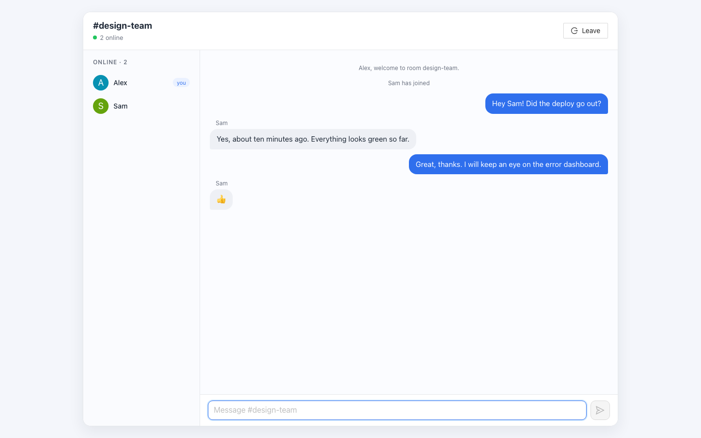
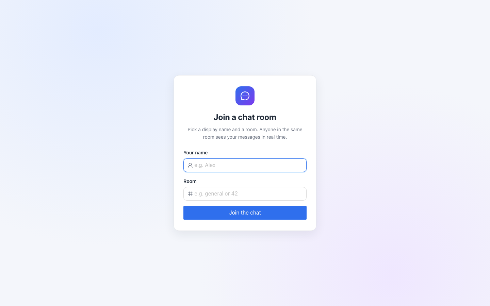
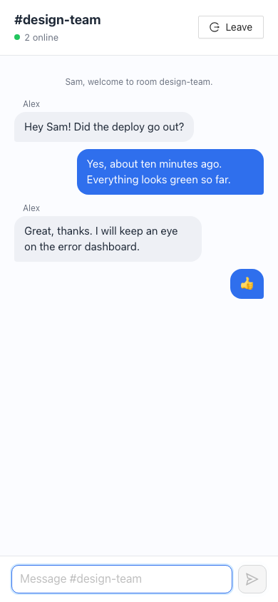

# Chat Application Frontend

A React client for a real-time, room-based chat app, using Socket.IO, Ant Design and styled-components.


> This is the client half of the project. It needs the Strapi + Socket.IO server at **[chat-application-backend](https://github.com/VamsiKrishnaThota03/chat-application-backend)**.



## Overview

Users enter a name and a room, join over a WebSocket, and exchange messages with everyone else in that room. The chat screen shows a live list of the room's members. The app was bootstrapped with Create React App.

## Features

- **Join screen** (`/join`): pick a display name and a room. Server errors (for example a name already taken in that room) are shown inline, and the button waits for the server connection.
- **Chat room** (`/chat/rooms/:room`): chat bubbles for your own and other people's messages, centred system notes for join/leave events, auto-scroll to the newest message, send with Enter
- **Members panel** with coloured initials, updated from the server's `roomInfo` events (hidden on small screens; the header shows the online count)
- **Connection status** in the header and a banner with a Rejoin action if the connection drops
- **Leave** disconnects cleanly and returns to the join screen; opening a room URL without joining redirects to `/join`
- Responsive layout (desktop and mobile), accessible labels and focus styles, custom favicon and title

<p>
  
  
</p>

## Tech stack

- React 17 (Create React App / `react-scripts` 5)
- React Router 5 with a shared `history` object
- `socket.io-client` 4
- Ant Design 4 (+ `@ant-design/icons`), styled-components 5
- `react-scroll-to-bottom`
- Jest + Testing Library

## Project structure

```
src/
├── App.js                    # Routes: /join and /chat/rooms/:room, join/leave state
├── index.js                  # Router setup, global CSS imports
├── hooks.js                  # useSocketConnected()
├── theme.js                  # Colours and avatar colour helper
├── config/
│   ├── network.js            # Browser history instance
│   └── web-sockets.js        # Socket.IO client and server URL
├── screens/
│   ├── JoinRoom/             # Name and room form
│   └── ChatRoom/             # Message view and composer
└── components/
    ├── Header/               # Room name, online count, leave button
    ├── List/                 # Members panel
    └── Messages/             # Message list, bubbles and system notes
```

## Getting started

### Prerequisites

- Node.js 18+ and npm
- A running instance of [chat-application-backend](https://github.com/VamsiKrishnaThota03/chat-application-backend). It listens on `http://localhost:1337` by default.

### Install and run

```bash
git clone https://github.com/VamsiKrishnaThota03/chat-application-frontend.git
cd chat-application-frontend
npm install
cp .env.example .env      # optional: point at another backend
npm start
```

Open <http://localhost:3000>.

### Environment variables

| Variable                | Description                              | Default |
|-------------------------|------------------------------------------|---------|
| `REACT_APP_SERVER_URL`  | URL of the chat backend (used in dev and production builds) | `http://localhost:1337` |

### Scripts

| Command         | Purpose                         |
|-----------------|---------------------------------|
| `npm start`     | Start the dev server            |
| `npm run build` | Create a production build in `build/` |
| `npm test`      | Run the Jest tests (`CI=true npm test` for a single run) |

The backend must allow your frontend's origin in its `CORS_ORIGINS` setting.

## Known limitations

- There are no accounts: names are only unique per room while connected, and anyone who knows a room name can join it.
- Messages are not stored. Refreshing the page or reconnecting starts with an empty history and you need to rejoin.
- `npm audit` reports advisories in Create React App 5's build tooling (webpack-dev-server, PostCSS, etc.). They affect the dev server/build only and cannot be fixed without leaving CRA.
