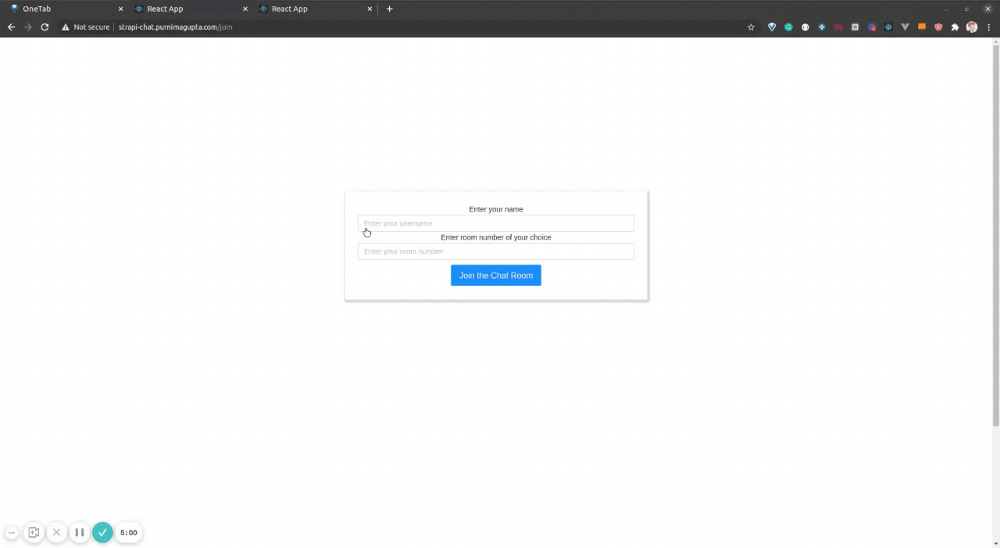

# Chat Application Frontend

A React client for a real-time, room-based chat app, using Socket.IO, Ant Design and styled-components.


> This is the client half of the project. It needs the Strapi + Socket.IO server at **[chat-application-backend](https://github.com/VamsiKrishnaThota03/chat-application-backend)**.



## Overview

Users enter a name and a room, join over a WebSocket, and exchange messages with everyone else in that room. The chat screen shows a live list of the room's active users. The app was bootstrapped with Create React App.

## Features

- **Join screen** (`/join`): pick a username and a room. Errors from the server, such as a duplicate name in the room, are shown as alerts.
- **Chat room** (`/chat/rooms/:roomNumber`): messages from the room, including bot welcome, join and leave messages, with auto-scroll to the newest message
- **Active users panel**, updated from the server's `roomInfo` events
- **Leave button** in the header that returns to the join screen
- If you open a chat room URL without joining first, you are redirected to `/join`

## Tech stack

- React 17 (Create React App / `react-scripts` 4)
- React Router 5 with a shared `history` object
- `socket.io-client` 3
- Ant Design 4, styled-components 5, Font Awesome 4
- `react-scroll-to-bottom`

## Project structure

```
src/
├── App.js                    # Routes: /join and /chat/rooms/:roomNumber
├── index.js                  # Router setup, global CSS imports
├── config/
│   ├── network.js            # Browser history instance
│   └── web-sockets.js        # Socket.IO client and server URL
├── screens/
│   ├── JoinRoom/             # Username and room form
│   └── ChatRoom/             # Message view and input
├── components/
│   ├── Header/               # Room name and leave button
│   ├── List/                 # Active users list
│   └── Messages/             # Message list and single message bubble
└── img/strapi-chat.gif       # Demo animation
```

## Getting started

### Prerequisites

- Node.js 14.x and npm 6 (pinned in `package.json` `engines`)
- A running instance of [chat-application-backend](https://github.com/VamsiKrishnaThota03/chat-application-backend). It listens on `http://localhost:1337` by default.

### Install and run

```bash
git clone https://github.com/VamsiKrishnaThota03/chat-application-frontend.git
cd chat-application-frontend
npm install
npm start
```

Open <http://localhost:3000>.

### Environment variables

In development the client always connects to `http://localhost:1337`. For production builds, set:

| Variable                | Description                              | Example                               |
|-------------------------|------------------------------------------|---------------------------------------|
| `REACT_APP_SERVER_URL`  | URL of the deployed chat backend         | `<https://your-backend.example.com>`  |

### Scripts

| Command         | Purpose                         |
|-----------------|---------------------------------|
| `npm start`     | Start the dev server            |
| `npm run build` | Create a production build in `build/` |
| `npm test`      | Run Jest via `react-scripts`    |

The backend must allow your frontend's origin through its `CUSTOM_DOMAIN` / `REACT_APP_URL` CORS settings.
